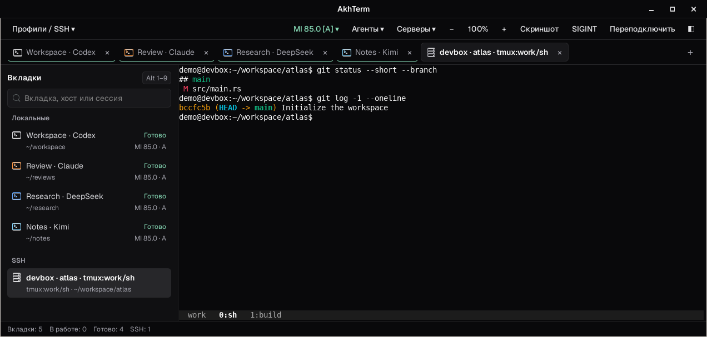

# AkhTerm

AkhTerm is a native Linux terminal built with Rust, GTK 3 and VTE. It puts local shells, SSH connections and remote tmux sessions in one window. It remembers the open tabs, their order, the active tab and the working directories of local shells.



## Install the Debian package

The `amd64` package was tested on Ubuntu 24.04 and 26.04. Open the `.deb` in your graphical package installer, or install it with APT from the directory containing the file.

```sh
sudo apt install ./akhterm_0.3.0-1_amd64.deb
```

Start **AkhTerm** from the application menu or run `akhterm`. Remove it with `sudo apt remove akhterm`. Your configuration and saved tabs stay in your home directory.

The [Build Debian package workflow](.github/workflows/build-deb.yml) runs on pushes and pull requests and can also be started manually. It builds the package on Ubuntu 24.04 and checks installation in Ubuntu 24.04 and 26.04 containers. Download the `.deb` from **Artifacts** on a successful run in GitHub Actions.

## Build and run

On Debian or Ubuntu, install the native build dependencies. Rust and Cargo are also required. The build was verified with Rust and Cargo 1.85.

```sh
sudo apt install build-essential libfontconfig-dev libgtk-3-dev libvte-2.91-0
cargo build --release --offline --locked
./target/release/akhterm
```

Cargo needs no external Rust crates. AkhTerm runs in a Linux graphical session. SSH tabs use the `ssh` executable, and remote tmux tabs require `tmux` on the remote host. The optional system monitor uses `htop`.

To build the `.deb` on an Ubuntu 24.04 base, install `dpkg-dev` and run the packaging script from the source directory. It writes the package to `target/deb/`.

```sh
sudo apt install dpkg-dev
./packaging/build-deb.sh
```

## Try it

1. Click `+` in the tab strip or press `Ctrl+Shift+T` to open another local tab. Change to a project directory with `cd`.
2. Close AkhTerm and run it again. The tab opens in that directory and focus returns to the previously active tab.
3. If you already have an alias in `~/.ssh/config`, open the «Профили / SSH» menu. Choose `ssh` for a remote shell or `tmux:main` for a persistent session. Use `Ctrl+Shift+R` to reconnect the active SSH tab and return to its tmux session. Running an interactive `ssh` session inside a local shell tab moves that tab into the «SSH» sidebar group while connected and returns it to «Локальные» when `ssh` exits.

`Ctrl+Shift+D` splits the active local tab vertically and `Ctrl+Shift+E` splits it horizontally in the current foreground directory. `Ctrl+Shift+W` closes the focused or secondary split pane first, or closes the active tab when one pane remains, and `Ctrl+Shift+U` jumps to the next tab waiting for approval («Ждёт апрува») or with unread output («Готово»). Press `Ctrl+Shift+F` (or choose «Поиск по выводу» in the command palette) to search terminal output and scrollback in the active pane (`Enter` jumps to the next match, `Shift+Enter` jumps to the previous match, `Aa` toggles case sensitivity, `.*` toggles PCRE2 regex mode, and `Escape` closes the bar and returns focus to the terminal). Press `Ctrl+Shift+L` or click `☀` / `☾` in the top bar to switch live between the Dark Zinc and Light Zinc themes across the window and all open terminal panes. Clicking a relative `file:line` path in terminal output opens that file from the session's current directory, and dragging files onto a terminal pane inserts their shell-escaped local paths or uploads them to `/tmp/` via `scp` in the background on SSH tabs. The `×` button closes its own tab, and `Alt+1` through `Alt+9` select tabs by position. Press `Ctrl+Shift+P` or `Ctrl+K` to open the command palette and jump across open tabs, live remote `tmux` sessions, local profiles, SSH hosts, agents, theme switching and Handoff files (`Up`/`Down` selects, `Enter` runs, and `Escape` returns focus to the terminal). The interface labels are in Russian.

In a shell tab, open «Агенты» and choose **Claude Code** to run `claude` in that shell, or pick one of the compact `⎇` actions in the same menu to create a sibling Git worktree (`<repo>-wt-<agent>-<stamp>` on branch `wt/<agent>-<stamp>`) and launch the agent in a new tab. Local tabs inside a Git repository display their active branch (with `[wt]` for linked worktrees) in the sidebar and match branch names in sidebar search. Install the [Claude Code CLI](https://code.claude.com/docs/en/quickstart) on the machine where the shell runs. When an agent pauses on a confirmation prompt or finishes a long run while the window is unfocused, AkhTerm highlights the tab and sends a desktop notification if `notify-send` is installed. Active agent turns show a live elapsed timer (`⏱`) on the tab and sidebar row, compact context usage (`ctx`) next to `MI`, and a per-tab and window-total `input · cache · output` breakdown in «Токены ▾» from local `AGY`, `Claude Code` and `Codex CLI` JSONL logs or remote `tmux` status lines.

## Local configuration

With a fresh profile, AkhTerm opens one local shell in `~`. SSH monitoring and startup connections are opt-in.

```sh
config_dir="${XDG_CONFIG_HOME:-$HOME/.config}/akhterm"
mkdir -p "$config_dir"
cp -n /usr/share/doc/akhterm/config.example.conf "$config_dir/config.conf"
```

If you built from source, copy [config.example.conf](config.example.conf) from the source directory. Set `AKHTERM_CONFIG` to use a different file. Paths can be absolute, `~`, or start with `~/`. Separate fields with `|`. Lines beginning with `#` are comments.

| Setting | Purpose |
| --- | --- |
| `local \| key \| title \| icon \| directory` | Adds a named shell tab to the menu. |
| `monitor \| key \| title \| icon \| directory` | Adds an `htop` tab. |
| `new-tab \| key` | Selects the profile used by `Ctrl+Shift+T`. |
| `startup \| key` | Opens a local profile on the first run. Repeat to set the order. |
| `startup-ssh \| host \| session` | Opens a remote tmux session on the first run. Omit the session field for a plain SSH tab. |
| `watch \| host` | Enables tmux and GPU polling for a host until changed in the SSH settings menu. |
| `shell \| /path/to/shell` | Overrides the shell from `$SHELL`. |
| `theme \| dark` | Sets the default Zinc theme (`dark` or `light`) before a manual toggle is saved. |
| `briefs \| directory` | Adds a directory of Markdown briefs to the Handoff menu and uses it for saved terminal captures. |
| `mi-root \| directory` | Adds a fallback project directory for the Maintainability Index. |

AkhTerm stores tab layout, the selected theme (`theme-v1`) and SSH monitoring preferences under `$XDG_STATE_HOME/akhterm`, or `~/.local/state/akhterm`. Saved tabs and theme preferences take precedence over startup and `theme` entries in `config.conf`. Restoring a tab starts a fresh shell or SSH client. A remote tmux session retains its running processes.

Keep machine-specific configuration and saved state local. Use [config.example.conf](config.example.conf) as the shareable template.

## Run the tests

```sh
cargo test --offline --locked
```

## License

AkhTerm is licensed under the [MIT License](LICENSE). The Debian package includes [notices for the system libraries](packaging/NOTICE).

The interface bundles [Geist 1.7.0](https://github.com/vercel/geist-font/releases/tag/1.7.0) under the [SIL Open Font License 1.1](assets/fonts/OFL-Geist.txt).
