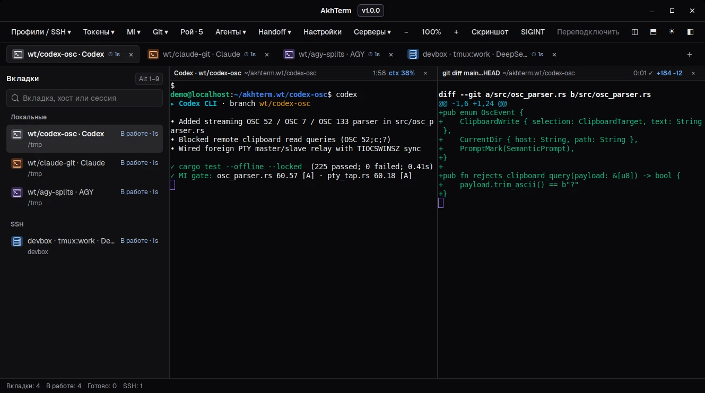
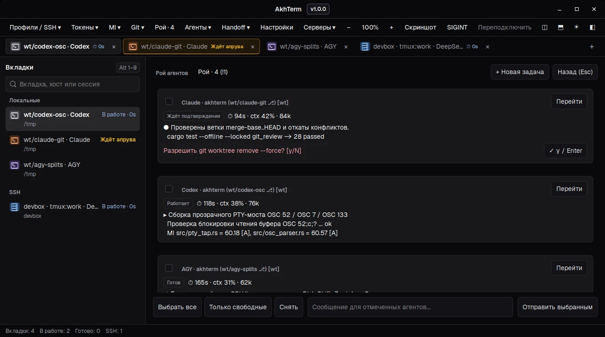

# AkhTerm

AkhTerm is a native Linux terminal built with **Rust**, **GTK 3**, and **VTE 2.91** with **zero external Cargo crates**. It unifies local shells, parallel CLI coding agents in isolated `git worktree` branches, split panes, and remote `SSH` / `tmux` sessions in one fast window, restoring your tabs, pinned titles, split layouts, and local working directories on restart.



<details>
<summary><strong>More screenshots (Swarm Dashboard &amp; SSH / tmux tabs)</strong></summary>

<br>




</details>

## Key Features

### Multi-Agent Swarm & Git Worktrees
- **Task Dispatch (`Ctrl+Shift+N`):** Fan out a multi-line prompt, local `.md` brief, or GitHub Issue across multiple CLI agents (`Codex`, `Claude Code`, `AGY`, `DeepSeek`, `Kimi`), automatically creating an isolated sibling `git worktree` (`wt/<slug>`) per agent.
- **Swarm Dashboard (`Ctrl+Shift+S`):** Overview grid of all active agent panes with ANSI-stripped output previews, 1-click **Quick Approve**, direct pane focus jump, and targeted multi-pane prompt **Broadcast** (`Escape` returns to your previous terminal).
- **1-Click Agent Worktrees (`Агенты` / `Agents`):** Run an agent directly in the current shell, or click `⎇` next to any agent to create a sibling worktree (`<repo>-wt-<agent>-<stamp>` on branch `wt/<agent>-<stamp>`) in a new tab. Install each CLI (for example, [Claude Code](https://code.claude.com/docs/en/quickstart)) on the host where the shell runs.
- **Two-Layer Git Review & Cleanup (`Git ▾` / `Ctrl+Shift+G`):** Shows active branch (`[wt]` for linked worktrees) and asynchronous dirty stats (`+ins -del` or `±files`) in the sidebar and top bar. Inspect both uncommitted working-tree changes and committed `wt/*` branch history (`merge-base..HEAD` vs `main`/`master`), open file or branch diffs in a vertical split pane, open untracked files externally, and merge or remove clean `wt/*` worktrees in one click.

### Per-Pane Radar, Telemetry & PTY/OSC Bridge
- **Per-Pane Status Headers:** Multi-pane tabs show a compact `22 px` header on each pane with agent/process state, exit code, live elapsed turn timer (`⏱`), and context usage (`ctx`) alongside the project Maintainability Index (`MI`).
- **Attention Jump & Notifications:** `Ctrl+Shift+U` jumps straight to the next pane waiting for confirmation or holding unread output. When unfocused, AkhTerm highlights the tab and sends a desktop notification (`notify-send`) on approval prompts or long commands (`>= notify-secs`).
- **Deduplicated Token Accounting (`Токены ▾` / `Tokens ▾`):** Per-tab and window-total `input · cache · output` breakdown read from local and remote SSH `AGY`, `Claude Code`, and `Codex CLI` JSONL transcripts or remote `tmux` status lines.
- **Transparent `OSC 52` / `OSC 7` / `OSC 133` PTY Bridge:** User-space PTY tap over `VTE 2.91` enabling write-only `OSC 52` clipboard copy across `SSH` and `tmux` (`?` clipboard read queries are strictly blocked), `OSC 7` working-directory tracking, and `OSC 133` command completion notifications.

### Splits, Tabs & Remote Sessions
- **Local & Remote Splits:** Split panes vertically (`Ctrl+Shift+D`) or horizontally (`Ctrl+Shift+E`) in the foreground directory across local shells, plain `SSH` tabs, and remote `tmux` tabs (attaching grouped `tmux` sessions so splits share server windows with independent focus).
- **Layout Persistence (`tabs-v2`):** Restores tab order, active tab, pinned custom titles, nested split trees, and local directories on restart.
- **SSH & `tmux` Grouping:** Open plain `SSH` shells or persistent `tmux` sessions from `Профили / SSH` and reconnect dropped sessions with `Ctrl+Shift+R`. Running an interactive `ssh` command inside a local tab automatically moves that tab into the `SSH` sidebar group until `ssh` exits.

### Everyday Terminal Ergonomics
- **Command Palette (`Ctrl+Shift+P` / `Ctrl+K`):** Fuzzy launcher across open tabs, live remote `tmux` sessions, profiles, SSH hosts, agents, theme/locale switches, Settings, About, Swarm Dashboard, Task Dispatch, and Handoff briefs.
- **Scrollback Search (`Ctrl+Shift+F`):** Search active-pane output with `Enter` / `Shift+Enter`, case sensitivity (`Aa`), and PCRE2 regex (`.*`).
- **Smart Clipboard, Links & File Drop:** `Ctrl+C` copies selected text or sends `SIGINT` when nothing is selected; `Ctrl+V` pastes text, clipboard images, or copied files; `Ctrl+Click` opens URLs and relative `file:line` paths without interfering with left-click drag selection; dragging files onto a pane inserts shell-escaped paths locally or uploads them to `/tmp/` via background `scp` on `SSH` tabs.
- **Context Menus & Mouse Passthrough:** Right-click inside a terminal pane to copy, paste, open/copy a URL or `file:line` path, open its parent directory (**Открыть папку** / **Open Containing Folder**), forward selected text or recent output to another tab, split/close panes, or clear scrollback. `Shift + Right-Click` passes straight through to `tmux`, `vim`, and other mouse-aware TUI apps. Right-clicking a tab or sidebar row renames, duplicates, copies the local path, reconnects, or closes tabs.
- **Live Settings & Bilingual UI (`Ctrl+,`):** Switch live between **Dark Zinc** and **Light Zinc** (`Ctrl+Shift+L` or `☀` / `☾`), toggle **Russian / English** UI text live, adjust font, scrollback, `OSC 52`, and notification thresholds, or inspect build metadata in **About** (`akhterm --version`).

## Keyboard & Mouse Shortcuts

### Tabs & Split Panes

| Shortcut / Gesture | Action |
| --- | --- |
| `Ctrl+Shift+T` | Open a new local tab |
| `Ctrl+Shift+W` | Close the focused split pane, or close the active tab when one pane remains |
| `Ctrl+Shift+D` / `Ctrl+Shift+E` | Split active pane vertically / horizontally (local, `SSH`, or `tmux`) |
| `Alt+Arrow` | Move focus directionally between split panes |
| `Ctrl+Shift+Z` | Toggle temporary zoom on the focused split pane |
| `Alt+1` – `Alt+9` | Select tab by position |
| `Ctrl+Shift+PageUp` / `PageDown` | Reorder the active tab (mouse drag also reorders tabs) |
| Double-click tab | Pin or reset a custom tab title that stays fixed across `cd` |
| `Ctrl+Shift+R` | Reconnect the active remote `SSH` / `tmux` tab |

### Agents, Git & Navigation

| Shortcut | Action |
| --- | --- |
| `Ctrl+Shift+N` | Open multi-agent **Task Dispatch** across isolated `git worktree` branches |
| `Ctrl+Shift+S` | Toggle **Swarm Dashboard** (`Escape` returns to terminal) |
| `Ctrl+Shift+U` | Jump to the next pane waiting for approval or holding unread output |
| `Ctrl+Shift+G` | Open **Git** dirty status, branch review (`merge-base..HEAD`), diff, and worktree cleanup |
| `Ctrl+Shift+P` / `Ctrl+K` | Open **Command Palette** (`Up`/`Down` selects, `Enter` runs, `Escape` closes) |
| `Ctrl+Shift+F` | Search terminal output and scrollback (`Enter` / `Shift+Enter`, `Aa`, `.*`, `Escape`) |

### Clipboard, Appearance & Mouse

| Shortcut / Gesture | Action |
| --- | --- |
| `Ctrl+C` / `Ctrl+Shift+C` | Copy selected terminal text (`Ctrl+C` sends `SIGINT` when nothing is selected) |
| `Ctrl+V` / `Ctrl+Shift+V` | Paste text, clipboard images, or copied file paths |
| `Ctrl+Click` | Open URL or local `file:line` path under the cursor |
| `Shift + Right-Click` | Pass right-click directly through to `tmux`, `vim`, and mouse-aware terminal apps |
| `Ctrl+Shift+L` | Switch live between **Dark Zinc** and **Light Zinc** themes |
| `Ctrl+,` | Open **Settings** dialog |

## Install a Package

Prebuilt `.deb` and `.rpm` installers are attached to [GitHub Releases](https://github.com/akhtyamovpavel/AkhTerm/releases/latest) and built continuously in GitHub Actions.

### Debian and Ubuntu (`.deb`)

Tested on Ubuntu 24.04 and 26.04 (`amd64`):

```sh
sudo apt install ./akhterm_1.0.0-1_amd64.deb
```

Launch **AkhTerm** from your application menu or run `akhterm` (`akhterm --version` prints version and build metadata). Remove with `sudo apt remove akhterm` (your configuration and saved state in `~` are preserved). See [.github/workflows/build-deb.yml](.github/workflows/build-deb.yml) and [.github/workflows/release.yml](.github/workflows/release.yml).

### Fedora (`.rpm`)

Tested on Fedora 41 and 42 (`x86_64`), including KDE Breeze GTK 3 and icon packages:

```sh
sudo dnf install ./akhterm-1.0.0-1.x86_64.rpm
```

Launch **AkhTerm** from your application menu or run `akhterm`. Remove with `sudo dnf remove akhterm`. See [.github/workflows/build-rpm.yml](.github/workflows/build-rpm.yml).

AkhTerm runs natively under **Wayland** and **X11** on **GNOME** and **KDE Plasma** (`StartupWMClass=AkhTerm` in `org.akhterm.AkhTerm.desktop`).

## Quick Start

1. Click `+` in the tab strip or press `Ctrl+Shift+T` to open a local tab, then `cd` into a project directory.
2. Close AkhTerm and launch it again — your tab layout, working directories, and active focus are restored automatically.
3. If you have hosts in `~/.ssh/config`, open **Профили / SSH** and choose `ssh` for a remote shell or `tmux:main` for a persistent remote session (`Ctrl+Shift+R` reconnects).

## Build from Source

Install native GTK 3, VTE 2.91, and Fontconfig development packages plus Rust **1.85.1** (Cargo builds offline with zero external crates).

**Debian / Ubuntu:**

```sh
sudo apt install build-essential libfontconfig-dev libgtk-3-dev libvte-2.91-0
```

**Fedora:**

```sh
sudo dnf install gcc fontconfig-devel gtk3-devel vte291-devel
```

**Build & run:**

```sh
cargo build --release --offline --locked
./target/release/akhterm
```

Optional runtime tools: `ssh` (remote tabs), `tmux` on remote hosts, `htop` (monitor profile), `notify-send` (desktop notifications), and `wl-clipboard` (Wayland clipboard helpers).

**Build native installers locally:**

```sh
# Debian / Ubuntu (.deb -> target/deb/)
sudo apt install dpkg-dev
./packaging/build-deb.sh

# Fedora (.rpm -> target/rpm/)
sudo dnf install rpm-build
./packaging/build-rpm.sh
```

**Run the test suite:**

```sh
cargo test --offline --locked
```

## Local Configuration

With a fresh profile, AkhTerm opens a single local shell in `~`. SSH polling and startup sessions are opt-in.

```sh
config_dir="${XDG_CONFIG_HOME:-$HOME/.config}/akhterm"
mkdir -p "$config_dir"
cp -n /usr/share/doc/akhterm/config.example.conf "$config_dir/config.conf"
```

When building from source, copy [config.example.conf](config.example.conf) instead. Override the config path with `AKHTERM_CONFIG`. Paths may be absolute, `~`, or `~/...`; fields are separated by `|` and `#` starts a comment.

| Setting | Purpose |
| --- | --- |
| `local \| key \| title \| icon \| directory` | Adds a named local shell profile to the menu |
| `monitor \| key \| title \| icon \| directory` | Adds an `htop` system monitor profile |
| `new-tab \| key` | Selects the profile opened by `Ctrl+Shift+T` |
| `startup \| key` | Opens a local profile on first launch (repeat to set order) |
| `startup-ssh \| host \| session` | Opens a remote `tmux` session on first launch (omit `session` for plain `SSH`) |
| `watch \| host` | Enables background `tmux` and GPU polling for an SSH host |
| `shell \| /path/to/shell` | Overrides `$SHELL` for local tabs |
| `theme \| dark` | Sets initial Zinc theme (`dark` or `light`) before manual toggle |
| `locale \| auto` | Sets UI language (`auto`, `ru`, or `en`) |
| `font \| JetBrains Mono 11` | Sets terminal Pango font (`<family> <size>`) |
| `scrollback \| 10000` | Sets scrollback line limit (`100`–`100000`) |
| `osc52 \| on` | Enables or disables `OSC 52` clipboard write relay (`on` or `off`) |
| `notify-secs \| 15` | Minimum command/turn duration in seconds before sending desktop notifications |
| `briefs \| directory` | Adds a Markdown briefs folder to Handoff and Task Dispatch |
| `mi-root \| directory` | Sets fallback project directory for Maintainability Index (`MI`) |

Runtime state (`tabs-v2` layout, `theme-v1` selection, and SSH watch toggles) is saved atomically under `${XDG_STATE_HOME:-~/.local/state}/akhterm` and takes precedence over initial `startup` and `theme` entries in `config.conf`. Keep machine-specific hosts and paths out of version control; use [config.example.conf](config.example.conf) as a shareable template.

## License

AkhTerm is licensed under the [MIT License](LICENSE). Native `.deb` and `.rpm` packages include [third-party library notices](packaging/NOTICE).

The interface bundles [Geist 1.7.0](https://github.com/vercel/geist-font/releases/tag/1.7.0) under the [SIL Open Font License 1.1](assets/fonts/OFL-Geist.txt).
